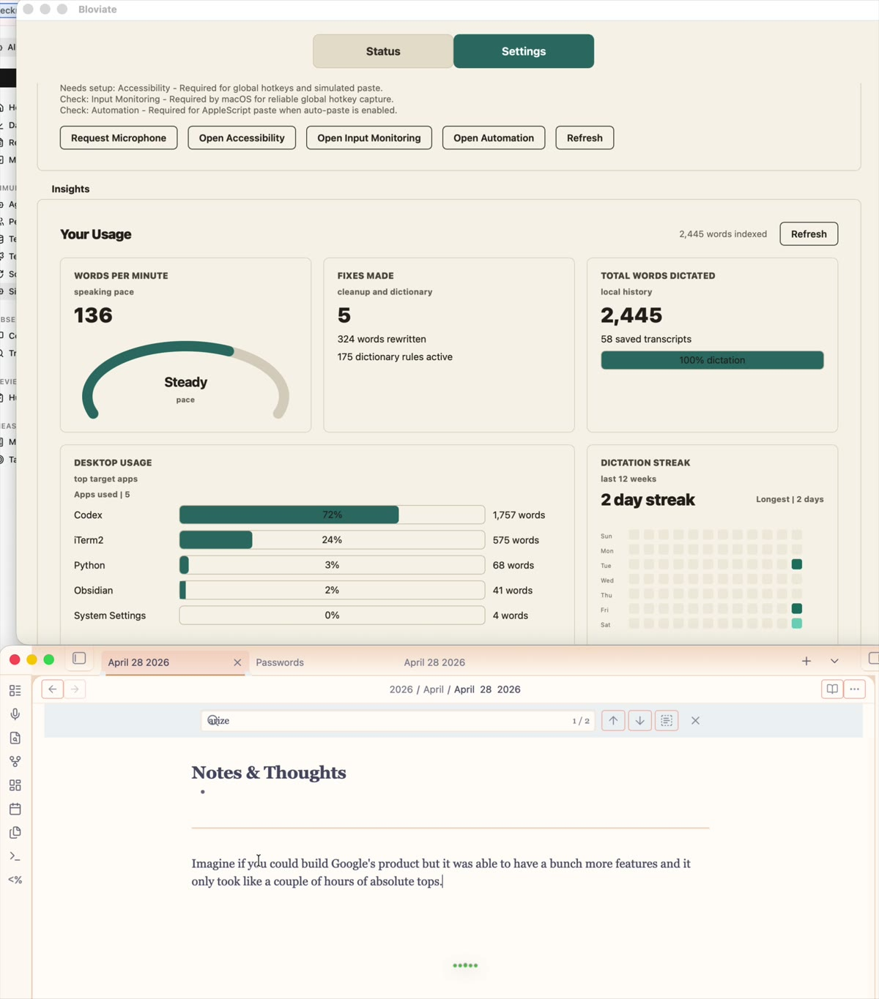

# Bloviate

Bloviate is a macOS-first voice dictation app for whispering in noisy spaces. It combines push-to-talk dictation, speaker verification, streaming transcription, an accuracy-first final pass, personal vocabulary, local history, and bring-your-own API keys.

## Demo



## What It Does

- Verifies your enrolled voice before transcribing in whisper mode, with per-device voice profiles
- Supports talk mode when you want normal dictation without speaker verification
- Supports hold-to-talk and toggle-to-talk; `Cmd+Option+Shift` toggles dictation by default
- Follows the system default microphone live and auto-calibrates speech gates per device
- Keeps a rolling pre-roll buffer so the first syllable of a dictation is never lost
- Runs isolated voice commands like `screen left half`, `run command desktop right`, or `open Slack`
- Uses Deepgram for live interim text, OpenAI or Deepgram for final text (within a hard latency budget), and local MLX Whisper / Whisper offline
- Lets you configure audio input, hotkeys, models, providers, API keys, dictionary, cleanup, history, startup behavior, and diagnostics from Settings
- Shows local usage insights in Settings: words dictated, speaking pace, cleanup fixes, app breakdown, and streak heatmap
- Tracks 500+ local achievements with generated badge art, progress search, secret unlocks, and opt-in AI-assisted content achievements
- Stores user config/state under `~/Library/Application Support/Bloviate`
- Keeps transcript history locally in SQLite; raw audio is not stored by default

## Current Status

Bloviate is a technical macOS beta. It is ready to demo and share with technical users, but it is not yet a signed/notarized consumer `.app`.

Recommended first public install path:

```bash
brew install portaudio python@3.12 pipx
pipx ensurepath
pipx install git+https://github.com/callumreid/Bloviate.git
```

Homebrew HEAD install for beta E2E testing:

```bash
brew tap callumreid/bloviate https://github.com/callumreid/Bloviate
brew install --HEAD callumreid/bloviate/bloviate
bloviate --install-launcher
```

See [INSTALL.md](/Users/bronson/personal/bloviate/INSTALL.md) for beta install, permissions, upgrades, and the signed-app roadmap.

## First Run

```bash
bloviate --doctor
bloviate --show-paths
bloviate --list-devices
bloviate --voice-mode talk
```

Then open Settings from the window or menu bar icon and configure. After `bloviate --install-launcher`, you can start Bloviate from `~/Applications/Bloviate.app` instead of a terminal. On first launch, Settings shows a permissions checklist with buttons for microphone, Accessibility, Input Monitoring, and Automation.

- microphone
- push-to-talk hotkey
- toggle dictation hotkey
- OpenAI / Deepgram API keys
- provider/model priority
- dictionary terms and corrections
- cleanup mode
- transcript history preference

For whisper verification mode:

```bash
bloviate --enroll
bloviate
```

## API Keys

Bloviate is bring-your-own-key. Settings saves OpenAI and Deepgram keys to macOS Keychain through `keyring` when available. Environment variables still work:

```bash
export OPENAI_API_KEY="..."
export DEEPGRAM_API_KEY="..."
```

The launcher sources `~/.zshenv` and `~/.zprofile` so common shell-defined API keys are visible when starting from `Bloviate.app`. Keychain storage is still preferred for public installs.

Provider priority defaults to:

1. OpenAI final pass
2. Deepgram final pass
3. Local Whisper fallback

## Personal Dictionary

The dictionary lives at:

```bash
~/Library/Application Support/Bloviate/personal_dictionary.yaml
```

It contains:

- `preferred_terms`: words/names/tools used to bias transcription
- `corrections`: deterministic rewrites for recurring mistakes

Example:

```yaml
preferred_terms:
  - Raycast
  - kubectl
  - gpt-4o-transcribe

corrections:
  - phrase: "kubectl"
    variations:
      - "cube cuddle"
      - "cube control"
    match: "substring"
```

You can edit this in Settings or from the CLI:

```bash
bloviate --init-personal-dictionary
bloviate --add-term "Raycast" --add-term "kubectl"
bloviate --show-personal-dictionary
```

Older repo-local `custom_dictionary.yaml`, `personal_dictionary.yaml`, and `learned_terms.txt` files are imported into the App Support dictionary on launch.

## Cleanup Modes

- Verbatim: keeps the transcription as returned by the speech model.
- Tidy: fixes repeated adjacent words, spacing, punctuation, and sentence casing while preserving your wording.
- Clean prose: removes common filler and normalizes sentences.
- Coding: avoids prose rewrites that would damage commands, filenames, or identifiers.
- Message: formats dictated text like a concise message; it differs most when OpenAI cleanup is enabled.

Per-app overrides live in `post_processing.app_modes` (for example `{"iTerm2": "coding", "Slack": "message"}`), so a global mode never silently rewrites a coding dictation.

Tap-to-cycle (three quick `Command` taps) is off by default because accidental taps silently change the output style; enable it with `ptt.mode_cycle_enabled: true`.

## Voice Commands

Voice commands only execute when the whole utterance is the command. If a command phrase appears inside a longer dictated paragraph, Bloviate treats it as text.

Window commands:

```text
window left half
window right half
window top half
window bottom half
window full screen
window exit full screen
window larger
window smaller
window top left quarter
window top right quarter
window bottom left quarter
window bottom right quarter
```

You can say `screen ...` instead of `window ...`, or prefix with `run command`, for example `run command screen left half`.

Desktop and app commands:

```text
desktop left
desktop right
run command desktop left
run command desktop right
open Slack
open the app iTerm
launch Chrome
start Calendar
```

## Local History

Transcript history is enabled by default and stored locally at:

```bash
~/Library/Application Support/Bloviate/history.sqlite
```

History stores text metadata such as timestamp, mode, provider, target app/window, voice score, and output action. It does not store raw audio by default. Whisper-mode voice rejections are still transcribed into history when possible, but they are not auto-pasted. You can search, copy, delete, clear, export, or disable history in Settings.

## Achievements

Bloviate includes a local achievement shelf with 534 usage-based achievements across dictation volume, apps used, speaking speed, streaks, dictionary entries, cleanup fixes, voice/profile usage, vocabulary shape, Easter eggs, and rare combinations. Achievements are stored in the same local SQLite database as history, while generated badge PNGs are cached under:

```bash
~/Library/Application Support/Bloviate/achievements/badges
```

Badge art is generated locally from deterministic achievement metadata; Bloviate does not ship hundreds of static image files. Achievements can be reset separately from transcript history. If you reset achievements, existing history before the reset is ignored for future achievement unlocks.

AI-assisted achievements are off by default. If you enable them in Settings and have an OpenAI key configured, Bloviate sends transcript text to OpenAI for compact achievement tags such as message, todo, meeting, bug report, documentation, action items, or summary. It stores only those tags locally, not raw AI prompts or responses.

## Easter Eggs

Bloviate includes a few local-only extras that do not affect dictated output:

- Click the `Bloviate` title in the app five times to unlock hidden themes.
- Alt-click the title to open Bloviate Labs.
- Say isolated commands like `bloviate surprise me`, `show the cows`, `activate lounge mode`, `activate terminal cow`, `activate after dark`, or `activate studio radio`.
- Settings > Appearance has a `Run Cows` button and a milestone-toast toggle.

These commands only fire when they are the entire dictated phrase, so a longer paragraph mentioning one of them still pastes as normal text.

## Permissions

On macOS, grant permissions to the app host you use to run Bloviate:

- Microphone: required for audio capture
- Accessibility / Input Monitoring: required for global hotkeys and auto-paste
- Automation/System Events: required for window-management commands

If running through Terminal or iTerm, grant permissions to that terminal app. If launching `~/Applications/Bloviate.app`, grant permissions to Bloviate.

## Reliability & Eval

- Every dictation logs one `[DictationSummary]` line (device, RMS, verify score, provider, latency, paste result), and Settings insights show paste reliability over the last 100 dictations.
- Voice-rejected transcripts are recoverable from the menu bar (`Paste Last Rejected Dictation`).
- Clips that contain no detectable speech are never sent to cloud STT, which is where near-silence used to come back as hallucinated words.
- `eval/` holds a WER/latency harness over your own recorded clips — see [eval/README.md](eval/README.md). Record with `bloviate --record-eval-clip <name>`.
- `bloviate --suggest-terms-from-vault` mines an Obsidian vault for dictionary term candidates.

## Fine-Tuning Local MLX Whisper on Your Whispered Voice

Commercial speech-to-text models degrade sharply on whispered speech in noisy offices (stock `whisper-large-v3-turbo` drops from `0.041` clean WER to `0.757` WER under 10–18 dB office babble). Bloviate includes an end-to-end synthetic + multi-condition LoRA fine-tuning pipeline in `eval/` that adapts `mlx-community/whisper-large-v3-turbo` directly on Apple Silicon using MLX:

### 1. How the Training Pipeline Works

1. **Personal Corpus Mining (`eval/build_whisper_dataset.py` & `eval/expand_whisper_dataset_v2.py`):**
   - Mines 671 utterances (**621 train / 50 strictly held-out eval**) across four sources:
     - `dictionary_carrier`: Every term and proper noun in `personal_dictionary.yaml` placed across varied conversational carrier templates (with unseen carrier templates held out for evaluation).
     - `history_dictation`: Real sentences mined from local `history.sqlite` dictations.
     - `obsidian_prose`: Technical prose mined from Markdown notes, with phonetic acronym normalization (`"C L I"` $\rightarrow$ `CLI`, `"P R"` $\rightarrow$ `PR`, `"S D K"` $\rightarrow$ `SDK`, `"p n p m vie test"` $\rightarrow$ `pnpm vitest`) so TTS speaks acronyms the way a human dictates them while the model learns to emit the exact written token.
     - `syntax_dictation`: Spoken CLI/git syntax pairs where TTS speaks `"git checkout dash b feat slash whisper eval"` and the target label is `"git checkout -b feat/whisper-eval"`.

2. **Whisper Voice Clone Synthesis + LPC Unvoiced Vocoder + Office Noise (`eval/synthesize_and_augment.py`):**
   - Synthesizes all utterances via a Gradium Pro Voice Clone recorded from close-mic whispered speech (`temp=0.0`, `cfg_coef=2.5`).
   - **Bridging the F0 Acoustic Trap:** Even when trained on whispered recordings, neural TTS voice clones retain residual pitch (`mean F0 ≈ 247–410 Hz`, ~40–68% voiced frames), whereas true human whispering is 100% unvoiced broadband turbulence (`0% voiced frames`). To prevent the ASR encoder from overfitting to synthetic pitch, `lpc_whisper_vocode()` extracts 20th-order Linear Predictive Coding (LPC) vocal-tract formants and replaces the periodic glottal excitation with modulated broadband noise—producing true `0.0% voiced` whisper signals (verified by `eval/validate_acoustics.py` and cepstral peak prominence gates).
   - Generates **1,242 multi-condition training clips** across `quiet`, `office_app_nogate` (10–18 dB speech-shaped office babble + Bloviate's +45 dB prerecorded AGC), `office_app` (with stationary spectral gating), and `unvoiced_lpc` (clean + noisy).

3. **Native Apple Silicon MLX LoRA Training (`eval/train_whisper_lora_mlx.py`):**
   - Attaches LoRA adapters (`r=16, alpha=32`, **5.57M trainable parameters / 0.69% of total**) to the top 12 `AudioEncoder` blocks and all 4 `TextDecoder` blocks, with **SpecAugment** frequency masking.
   - **Preserving Monotonic Timestamp Alignment:** `cross_attn.query` and `cross_attn.key` are deliberately kept frozen while adapting `cross_attn.value` and `cross_attn.out` alongside encoder/decoder self-attention and MLPs. Freezing cross-attention Q/K preserves Whisper's pre-trained monotonic alignment heads so tokens that compress multiple spoken words (e.g. `"feat slash"` $\rightarrow$ `"feat/"`) never trigger autoregressive repetition loops.
   - Merges the trained LoRA weights back into the base `float16` weights and exports a drop-in `mlx_whisper` checkpoint (`~/Library/Application Support/Bloviate/models/whisper-v3-turbo-callum-mlx`).

### 2. Benchmark Results (50 Held-Out Clips Across 6 Acoustic Conditions)

#### A. Raw Model Word Error Rate (WER — lower is better, no post-processing regexes)

| Model | Clean | Office No-Gate (14 dB) | Office Gate (14 dB) | Office Hard Noise (10 dB) | True Unvoiced LPC (Clean) | True Unvoiced LPC (14 dB) |
| :--- | :---: | :---: | :---: | :---: | :---: | :---: |
| `whisper-large-v3-turbo` (Stock MLX) | 0.114 | 0.153 | 0.144 | 0.280 | 0.134 | 0.169 |
| `whisper-v3-turbo-callum` (Round 1 LoRA) | 0.090 | 0.101 | 0.107 | 0.222 | 0.095 | 0.117 |
| **`whisper-v3-turbo-callum` (Round 2 LoRA)** | **0.056** | **0.068** | **0.079** | **0.157** | **0.059** | **0.085** |
| **Relative Error Reduction (v2 vs. Stock)** | **-51%** | **-56%** | **-45%** | **-44%** | **-56%** | **-50%** |

#### B. Breakdown by Dictation Category at 14 dB Office Noise (`office_app_nogate`)

| Category | Stock WER | Round 1 FT WER | **Round 2 FT WER** | Improvement |
| :--- | :---: | :---: | :---: | :--- |
| **`dictionary_carrier`** (Proper nouns, teammates, tools) | 0.072 | 0.023 | **0.013** | **-82% WER** (23/25 clips 0.00 WER without regexes) |
| **`history_dictation`** (Real Bloviate dictations) | 0.089 | 0.048 | **0.042** | **-53% WER** |
| **`obsidian_prose`** (Technical work notes & acronyms) | 0.259 | 0.211 | **0.144** | **-44% WER** |
| **`syntax_dictation`** (Spoken CLI/git commands) | 0.499 | 0.408 | **0.261** | **-48% WER** |

#### C. End-to-End Bloviate `Transcriber` vs. Cloud Providers

| Bloviate `Transcriber` Path | 16-Clip Clean WER | 16-Clip 14 dB Noisy WER | Full 50-Clip Clean WER | Full 50-Clip 14 dB Noisy WER | Mean Latency |
| :--- | :---: | :---: | :---: | :---: | :---: |
| `whisper` (Stock `whisper-large-v3-turbo`) | 0.100 | 0.090 | 0.109 | 0.140 | 0.42s |
| **`whisper` (Fine-Tuned `whisper-v3-turbo-callum-mlx`)** | **0.041** | **0.058** | **0.052** | **0.071** | **0.26s** |
| `openai` (`microsoft/mai-transcribe-1.5` via OpenRouter) | 0.047 | 0.060 | — | — | 2.03s |
| `deepgram` (`nova-3` prerecorded + 100 keyterms) | 0.057 | 0.121 | — | — | 0.81s |

### 3. Hardware Note: Close-Mic Condenser vs. AirPods for Whispering

Live testing across microphones confirmed a critical hardware boundary for true unvoiced whispering:
- **Close-talking XLR condenser (Focusrite Scarlett 4i4 + gooseneck, 48V phantom power, `stationary_noise_reduction: 0.0`):** Captures full 48 kHz broadband unvoiced whisper turbulence (`raw_rms ≈ 0.035` vs `0.0012` ambient floor, ~29 dB SNR). The fine-tuned local MLX model transcribes technical whispered sentences end-to-end on-device with high accuracy.
- **AirPods (`24 kHz` Bluetooth HFP):** AirPods use an internal bone-conduction voice accelerometer to gate their beamforming microphones. Because true unvoiced whispering has zero vocal-cord vibration, AirPods firmware clamps the mic output (`raw_rms ≈ 0.0011`, below the `0.0033` room floor) before audio ever reaches macOS. AirPods require at least a quiet voiced murmur to open the hardware gate, whereas a close-mic condenser works with pure unvoiced whispering.

### Running the Fine-Tuning Pipeline

```bash
venv/bin/python eval/build_whisper_dataset.py
venv/bin/python eval/expand_whisper_dataset_v2.py
GRADIUM_API_KEY="..." venv/bin/python eval/synthesize_and_augment.py
venv/bin/python eval/train_whisper_lora_mlx.py --epochs 2 --batch-size 4 --rank 16 --alpha 32 --top-encoder-layers 12
```

Then point `transcription.mlx_model` in `~/Library/Application Support/Bloviate/config.yaml` at the exported checkpoint directory and put `whisper` first in `final_pass_provider_priority`.

### Round 3 experiment: long-form windows (not deployed)

Real dictations are mostly long (30 s+ clips are ~68% of recorded audio time), but every training clip is 3–11 s. Round 3 added 600 packed 2–6 clip windows (≤29 s) with 50% timestamp targets. `eval/eval_longform.py` builds ~50 s passages from the non-templated held-out clips (only 3 passages, ~400 words, so treat as directional):

| WER | Round 2 (live) | Round 3 |
| :--- | :---: | :---: |
| long-form, clean | 0.110 | 0.082 |
| long-form, LPC-unvoiced | 0.135 | 0.096 |
| long-form, 14 dB office | 0.166 | 0.149 |
| per-clip, clean (50 clips) | 0.050 | 0.059 |

Long-form improved, but short clips regressed, and the checkpoint was chosen by a dev metric that double-applied noise (since fixed). Packed windows now never repeat a sentence template (`--packed-distinct-categories`), and packing is off by default. Re-run as round 3b with `--packed-windows 600 --timestamp-prob 0.5`. Splitting long audio at silences was also tested and did not help on natural passages.

### Training Data Capture

Bloviate can optionally save your real dictations as local audio + metadata so you can build a fine-tuning dataset from your actual whispered speech (the synthetic training set is 3–11s clips; real dictations are often 30s+). Enable it in `~/Library/Application Support/Bloviate/config.yaml`:

```yaml
training_capture:
  enabled: true
  max_hours: 20            # prune oldest audio beyond this many hours of total duration
  correction_hotkey: "<ctrl>+<option>+<cmd>"  # tap after fixing a pasted dictation
  correction_window_min: 30
```

When enabled, every accepted dictation (one that produced text and was not a voice command) is saved as 16-bit PCM WAV under `~/Library/Application Support/Bloviate/training_capture/audio/YYYY-MM-DD/<id>.wav`, with one JSON line per capture appended to `captures.jsonl` (capture id, history id, duration, sample rate, audio device, raw RMS, provider, raw transcript, post-processed/pasted text, streaming text, target app, outcome). Audio older than `max_hours` is pruned automatically.

To record a **gold correction**: fix the pasted text in the target app, select the whole corrected passage, and tap the correction hotkey. Bloviate saves your clipboard, simulates ⌘C, reads the selection, restores the clipboard, and matches it against the most similar capture from the last `correction_window_min` minutes (difflib ratio ≥ 0.5, selection at least 60% of the original length). A match appends to `corrections.jsonl` (capture id, corrected text, similarity, timestamp); an exact match is saved too as a confirmation label. If nothing matches, the status bar says so and nothing is written.

Everything stays local — no audio or text leaves your machine. Disable by setting `enabled: false` (or emptying the correction hotkey to turn off just the shortcut).

## Development

```bash
python -m venv venv
source venv/bin/activate
pip install -e .
python -m unittest discover -s tests
```

Useful commands:

```bash
python src/main.py --doctor
python src/main.py --list-devices
python src/main.py --show-paths
python src/main.py --voice-mode talk
```

## Release Roadmap

Current beta distribution is Homebrew prerequisites plus `pipx`.

Signed `.app` distribution is planned after beta hardening and requires:

- PyInstaller or similar app bundling
- stable icon/bundle identifier
- Apple Developer Program membership
- Developer ID signing certificate
- hardened runtime and notarization
- release CI that builds, signs, notarizes, and attaches artifacts

See [PRODUCTION_READINESS.md](/Users/bronson/personal/bloviate/PRODUCTION_READINESS.md) for launch posture and remaining readiness work.
